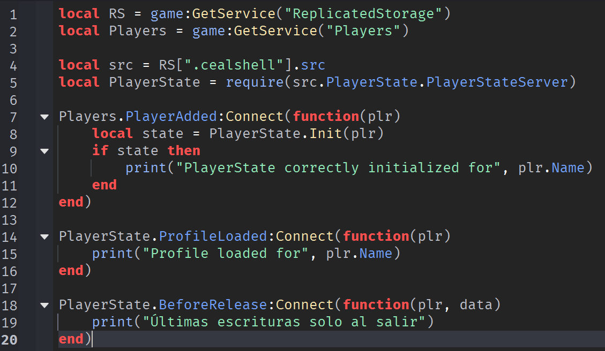

# PlayerState

<p align="center">
  Librería para gestionar el estado y los datos de los jugadores en Roblox.
</p>

<br>

## Lado del servidor

Para gestionar la carga y el guardado de datos, utilizaremos un Script dentro de **ServerScriptService (SSS)**.

<br>

### Inicialización

Primero, inicializamos los datos del jugador utilizando la siguiente función:

```lua
PlayerState.Init()
```

<br>

Luego, esperamos a que los datos del jugador se carguen completamente:

```lua
PlayerState.ProfileLoaded:Connect(function(plr, data)
   -- código aquí --
end)
```

<br>

Finalmente, detectamos cuándo el jugador abandona el juego para realizar las últimas modificaciones antes de guardar sus datos:

```lua
PlayerState.BeforeRelease:Connect(function(plr, data)
   -- últimas modificaciones antes de guardar --
end)
```

<br>

## Capturas de pantalla

<p align="center">
  
</p>

<br>
