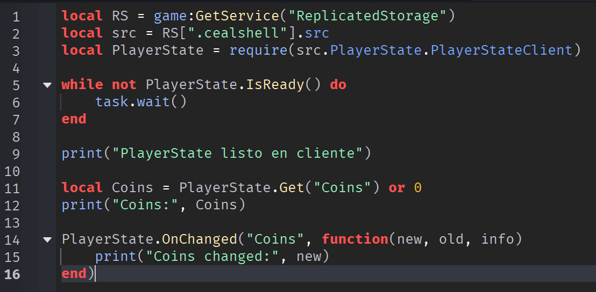

# PlayerState-Server

<br>

### Inicialización

inicio datos del jugador con:

```lua
PlayerState.Init()
```

<br>

atento cuando carguen:

```lua
PlayerState.ProfileLoaded:Connect(function(plr, data)
   -- código aquí --
end)
```

<br>

atento cuando se vaya:

```lua
PlayerState.BeforeRelease:Connect(function(plr, data)
   -- últimas modificaciones antes de guardar --
end)
```

<br>

## Capturas de pantalla

<p align="center">
  
</p>

<br>

# PlayerState-Client

<br>

Espero a que esten listos:

```
while not PlayerState.IsReady() do
	task.wait()
end
```

<br>

Obtengo datos: 

```
local Coins = PlayerState.Get("Coins") or 0
```

<br>

Atento a cualquier cambio en **"Coins"** para posterior actualizacion

```
PlayerState.OnChanged("Coins", function(new, old, info)
	print("Coins changed:", new)
end)
```

<br>

## Capturas de pantalla

<p align="center">
  
</p>

<br>

<a href="../README.md#proyectos">← Regresar</a>
