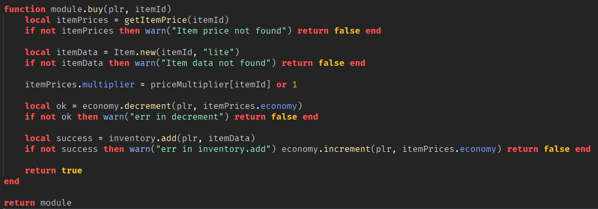

# Shop System

<br>

### Precios

obtengo la lista de precios y valido:

```luau
local itemPrices = getItemPrice(itemId)
if not itemPrices then warn("Item price not found") return false end
```

<br>

### Item

Creo el Item de manera "Lite" y valido:

```luau
local itemData = Item.new(itemId, "lite")
if not itemData then warn("Item data not found") return false end
```

<br>

### Aumento o Descuento

aplico el multiplicador a la lista de precios, si no existe igualo a 1 o a su valor original

```luau
itemPrices.multiplier = priceMultiplier[itemId] or 1
```

<br>

### Cobrar el Dinero

espero respuesta positiva de "economy" sobre el cobro del item y valido:

```luau
local ok = economy.decrement(plr, itemPrices.economy)
if not ok then warn("err in decrement") return false end
```

<br>

### Añadir Item al Inventario

Por ultimo, espero respuesta positiva de "inventory", caso contrario devuelvo el dinero gastado por seguridad:

```luau
local success = inventory.add(plr, itemData)
if not success then warn("err in inventory.add") economy.increment(plr, itemPrices.economy) return false end
```

<br>

# Funciones Auxiliares

<br>

```luau
function module.setPriceMultiplier(itemId, multiplier)
	priceMultiplier[itemId] = multiplier
end
```

```luau
local function getItemPrice(itemId: string)
	if not ItemInfo[itemId] then
		return false
	end
	local data = require(ItemInfo[itemId])
	return data.price
end
```

<br>

## Captura de Pantalla

<p>
  
</p>

<br>

**Modulos Usados para este Sistema:**  
[Item System](ItemSystem.md),  [Inventory System](InventorySystem.md),  [Economy System](EconomySystem.md)


<a href="../README.md#02-sistema-de-economía-y-tienda">← Regresar</a>
